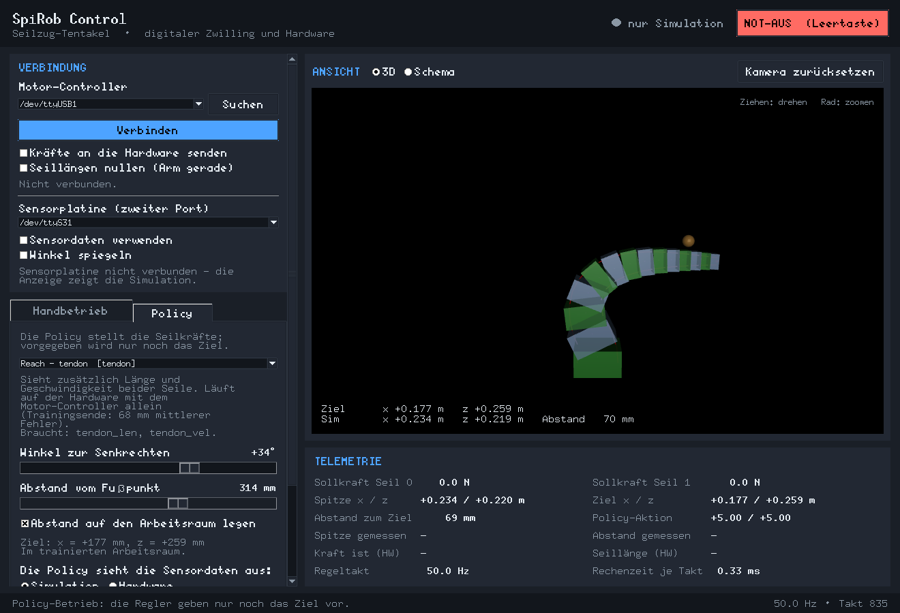

# SpiRob Control – grafische Bedienoberfläche für den Seilzug-Tentakel

Eine schlanke Desktop-Anwendung, mit der sich der SpiRob auf zwei Arten fahren
lässt: **von Hand** über zwei Schieberegler für die beiden Seilkräfte, oder
**über eine trainierte Policy**, der man nur noch sagt, wohin die Spitze soll.
Beides läuft immer gegen den mitgelieferten digitalen Zwilling (MuJoCo) und
kann per Knopfdruck auf die echte Hardware gelegt werden. Hängt die
Sensorplatine am zweiten USB-Port, zeigt die Anzeige die **gemessene** Form des
echten Arms, und die Policy kann auf den echten Gelenkwinkeln regeln.



## Projektinformationen

| Feld            | Wert                                                        |
| --------------- | ----------------------------------------------------------- |
| Projektname     | SpiRob Control                                               |
| Studiengang     | `<Studiengang eintragen>`                                    |
| Betreuer:in     | `<Name Betreuer:in eintragen>`                               |
| Abgabedatum     | `<TT.MM.JJJJ eintragen>`                                     |

## Team

| Name        |
| ----------- |
| Nico Beyer  |

## Kurzbeschreibung (Abstract)

Der SpiRob ist ein seilzuggetriebener Tentakelgreifer: eine Kette aus 14
Segmenten, die von zwei Seilen gebogen wird. Bisher ließ er sich nur über die
Regler des MuJoCo-Viewers oder über Kommandozeilenwerkzeuge ansteuern – für
Vorführungen, Messreihen und die Inbetriebnahme war das umständlich und
fehleranfällig. In diesem Projekt ist daraus eine eigenständige grafische
Oberfläche geworden, die den Roboter in zwei Betriebsarten fährt (Seilkräfte
von Hand oder Zielposition über eine im Reinforcement Learning trainierte
Policy), den Zustand gleichzeitig als 3D-Simulation und als Messwerte anzeigt
und die Kräfte auf Wunsch an den echten ESP32-Motorcontroller weiterreicht.
Damit die Anwendung auf einem beliebigen Windows-Rechner läuft, wurden die
trainierten Policies aus dem Trainingsprojekt in ein reines NumPy-Format
exportiert: die GUI kommt ohne PyTorch, ohne die Trainingsbibliotheken und
ohne GPU aus und ist nach `git clone` in unter einer Minute startklar.

## Ziele

- Eine Bedienoberfläche, mit der der SpiRob ohne Kommandozeile und ohne
  Vorwissen gefahren werden kann – zwei Schieberegler genügen.
- Die im Training gelernten Policies nutzbar machen, ohne die komplette
  Trainingsumgebung mitzuschleppen.
- Simulation und Hardware in **einer** Oberfläche, mit klarer Anzeige, welche
  von beiden gerade Kräfte bekommt.
- Die vorhandene Sensorik einbinden, sodass die Anzeige den echten Arm zeigt
  und jede trainierte Policy auch auf gemessenen Daten laufen kann.
- Lauffähig auf einem frisch aufgesetzten Windows-Rechner: klonen,
  `run_gui.bat` doppelklicken, fertig.

## Ergebnisse

- Zwei Hardwarequellen an zwei USB-Ports: der Motor-Controller (Seilkräfte,
  Seillängen) und die Sensorplatine (13 Gelenkwinkel aus 14
  Beschleunigungssensoren). Aus deren Winkeln folgt über die Vorwärtskinematik
  die tatsächliche Armform - damit wird aus dem angezeigten Zielabstand eine
  Messung statt einer Erwartung.
- Die Oberfläche steuert den digitalen Zwilling und die Hardware in einem
  einzigen Prozess mit stabilen 50 Hz Regeltakt; ein Regelschritt kostet rund
  0,2 ms, eine Bildausgabe 6 bis 8 ms (gemessen auf dem Entwicklungsrechner,
  Anzeige in der Statusleiste). Die Bildrate richtet sich nach der gemessenen
  Zeichendauer, damit auch ein Vollbild den Regeltakt nicht drückt.
- Vier trainierte Policies der Sensor-Ablation (`force`, `tendon`, `imu`,
  `joints`) sind als NumPy-Gewichte eingebunden und in der Simulation direkt
  auswählbar. Ihre Zielabweichung im Nachbau stimmt mit den Messwerten am Ende
  des Trainings überein (z. B. `joints` 42 mm) – der Export und der Nachbau der
  Beobachtung sind damit nachweislich korrekt.
- 51 automatisierte Tests sichern die kritischen Nahtstellen ab: das
  Beobachtungslayout, die Kraftabbildung, ein vollständiger Rollout bis ans
  Ziel und - über ein virtuelles Terminalpaar - der komplette Weg von den Bytes
  der Sensorplatine bis zum Gelenkwinkel.
- Die Anwendung läuft ohne PyTorch, mjlab oder CUDA; installiert werden nur
  MuJoCo, NumPy, pyserial und Pillow.

## Verwendete Technologien

- **Python 3.10+** mit **Tkinter** (Standardbibliothek) für die Oberfläche
- **MuJoCo** für den digitalen Zwilling und die 3D-Ansicht
- **NumPy** für den Vorwärtspass der Policies
- **pyserial** für die serielle Verbindung zu Motor-Controller und Sensorplatine
- **pytest** für die Tests, **Typst** für die schriftlichen Abgaben,
  **MkDocs Material** + GitLab CI/CD für Website und PDFs

## Schnellstart

**Windows:**

```bat
git clone <URL dieses Repositories>
cd spirob_control\src
run_gui.bat
```

`run_gui.bat` legt beim ersten Aufruf eine virtuelle Umgebung an, installiert
die Abhängigkeiten und startet die Oberfläche. Danach genügt ein Doppelklick
auf die Datei.

**Linux / macOS:**

```bash
git clone <URL dieses Repositories>
cd spirob_control/src
./run_gui.sh
```

Ohne angeschlossene Hardware startet die GUI im reinen Simulationsbetrieb –
alles außer dem Senden echter Kräfte funktioniert sofort. Die ausführliche
Bedienanleitung steht unter [Bedienung](docs/bedienung.md).

---

## Wie funktioniert dieses Repository?

Dieses Repository bündelt Code, Dokumentation und die schriftlichen Abgaben.
Die PDFs und die Website werden **automatisch von der GitLab-CI/CD-Pipeline**
gebaut – manuell kompiliert werden muss nichts.

| Ordner        | Zweck                                                                      |
| ------------- | -------------------------------------------------------------------------- |
| `src/`        | Der komplette Quellcode der GUI (`spirob_control/`), die Tests (`tests/`), das Exportwerkzeug für Policies (`tools/`) und die Startskripte. Details in `src/README.md`. |
| `docs/`       | Die Projektdokumentation, aus der die Website entsteht: Installation, Bedienung, Architektur, Hardware und Policies. |
| `expose/`     | Kurzes Exposé: Zielstellung, Forschungsfragen, Zeitplan, Literatur.        |
| `report/`     | Die schriftliche Arbeit in Typst (`main.typ` + `Sections/` + `references.bib`). |
| `slides/`     | Die Präsentation, ebenfalls in Typst.                                      |
| `extra/`      | Zusätzliches Material (Messreihen, Rohdaten, Exporte).                     |

### Was passiert automatisch?

Bei jedem Push auf `main` läuft die Pipeline (`.gitlab-ci.yml`) und

1. kompiliert `report/main.typ` zu einer PDF,
2. kompiliert `slides/main.typ` zu einer PDF,
3. kompiliert `expose/main.typ` zu einer PDF,
4. baut aus diesem README und `docs/` die Website (inkl. Downloads-Seite) und
   veröffentlicht sie über **GitLab Pages**.

Die PDFs werden nicht ins Repository zurückgeschrieben; sie entstehen nur im
CI-Lauf und hängen dort als Artefakt bzw. auf der Website unter „Downloads“.

### Was ist noch zu tun?

- Die drei mit `<...>` markierten Felder oben (Studiengang, Betreuer:in,
  Abgabedatum) ausfüllen.
- Exposé, schriftliche Arbeit und Präsentation weiter ausformulieren – die
  Rohfassungen in `expose/`, `report/` und `slides/` sind bereits mit dem
  Inhalt dieses Projekts gefüllt.
- Messreihen auf der echten Hardware ergänzen: Die Oberfläche zeigt den
  gemessenen Zielabstand jetzt live an, aufgezeichnet wird er noch nicht
  (siehe [Hardware](docs/hardware.md), Abschnitt „Was noch fehlt“).
