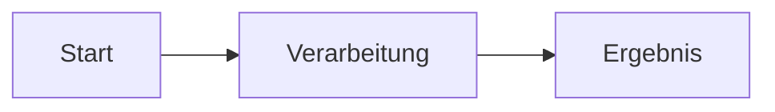

# Anleitung: Eigene Dokumentationsseiten schreiben

Diese Seite erklärt kurz, wie du weitere Seiten zur Website hinzufügst. Du
brauchst dafür nur normales Markdown – kein HTML- oder Webentwicklungs-Wissen.

## 1. Neue Seite anlegen

Lege eine neue `.md`-Datei in diesem Ordner (`docs/`) an, zum Beispiel
`docs/architektur.md`.

## 2. Seite in die Navigation eintragen

Öffne `mkdocs.yml` im Projektwurzelverzeichnis und ergänze die Datei unter
`nav:`:

```yaml
nav:
  - Start: index.md
  - Dokumentation:
      - Übersicht: dokumentation.md
      - Anleitung: anleitung.md
      - Architektur: architektur.md   # <- neue Seite
  - Downloads: downloads.md
```

Ohne diesen Eintrag ist die Seite zwar theoretisch erreichbar, taucht aber
nicht im Menü auf.

## 3. Markdown-Grundlagen (Beispiele)

**Überschriften:**

```markdown
# Große Überschrift
## Kleinere Überschrift
```

**Listen:**

```markdown
- Punkt 1
- Punkt 2
  - Unterpunkt
```

**Links:**

```markdown
[Linktext](https://example.com)
[Link auf eine andere Doku-Seite](dokumentation.md)
```

**Bilder** (Bilddatei einfach mit in `docs/` ablegen, z. B. `docs/bilder/foto.png`):

```markdown

```

**Code-Blöcke mit Syntax-Highlighting:**

````markdown
```python
def hallo():
    print("Hallo Welt")
```
````

## 4. Grafiken, Plots und Diagramme einbinden

**Bilder und Plots (z. B. aus Python/Matplotlib, Excel, Screenshots):**
Exportiere den Plot als PNG oder SVG, lege die Datei z. B. unter
`docs/bilder/` ab und binde sie wie ein normales Bild ein (siehe oben):

```markdown

```

Es gibt keine Live-Ausführung von Python o. Ä. beim Website-Build – Plots
müssen also vorher als Bilddatei exportiert und mit eingecheckt werden.

**Diagramme/Flowcharts (Mermaid):** Für Ablaufdiagramme, Architekturskizzen
o. Ä. muss kein Bild erstellt werden – Diagramme können direkt als Text
geschrieben werden und werden automatisch gerendert:

````markdown

````

Das ergibt z. B.:


Weitere Diagrammtypen (Sequenzdiagramme, Gantt-Charts, Klassendiagramme etc.)
sind in der [Mermaid-Dokumentation](https://mermaid.js.org/) beschrieben.

## 5. Website lokal testen

Damit du Änderungen nicht erst über die CI/CD-Pipeline sehen musst, kannst du
die Website lokal bauen und im Browser ansehen:

```bash
pip install mkdocs mkdocs-material
mkdocs serve
```

Danach im Browser `http://127.0.0.1:8000` öffnen. Die Seite aktualisiert sich
automatisch, sobald du eine Datei in `docs/` speicherst.

## 6. Wohin mit was?

| Ich möchte …                                      | Das gehört nach …                          |
| -------------------------------------------------- | ------------------------------------------- |
| eine neue Dokumentations-/Erklärseite schreiben     | `docs/` (siehe oben)                        |
| Bilder oder Diagramme für die Doku einbinden        | `docs/bilder/` (frei wählbarer Unterordner) |
| ein Datenset, Messwerte, Exporte o. Ä. ablegen      | `extra/` (siehe Haupt-README)                |
| Programmcode                                        | `src/`                                      |
