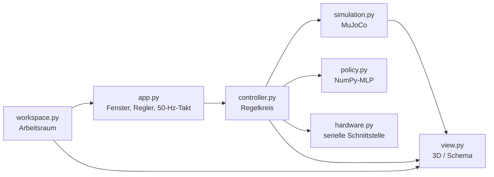

# Architektur

## Leitgedanke

Die Oberfläche soll robust sein – also wenig können, das aber verlässlich. Das
hat drei Entwurfsentscheidungen bestimmt:

1. **Ein Thread.** Regelkreis und Anzeige laufen im selben Tk-Ereignisstrom.
   Es gibt keine Sperren, keine Warteschlangen und keine Wettläufe zwischen
   Anzeige und Regelung.
2. **Keine Trainingsbibliotheken zur Laufzeit.** Die Policies liegen als
   NumPy-Gewichte im Repository. Damit hängt der Betrieb nicht an PyTorch,
   mjlab, einer CUDA-Version oder einem GPU-Treiber.
3. **Die Simulation läuft immer.** Sie ist Anzeige und Vergleichsmaßstab
   zugleich; die Hardware ist eine Zugabe, die man dazuschalten kann.

## Bausteine



| Modul            | Verantwortung                                                        |
| ---------------- | -------------------------------------------------------------------- |
| `app.py`         | Fenster, Bedienelemente, Takt; enthält keine Fachlogik                |
| `controller.py`  | ein Regelschritt: Modus, Kräfte, Sicherheitsgrenze, Telemetrie        |
| `simulation.py`  | MuJoCo-Modell, Regelschritt, alle Sensorsignale, Kettenpunkte         |
| `policy.py`      | Beobachtungsvektor bauen, Vorwärtspass, Aktion begrenzen              |
| `hardware.py`    | serielle Verbindung, Telemetrie, Kraftkommandos – nicht blockierend   |
| `view.py`        | 3D-Bild aus MuJoCo bzw. 2D-Schema, Mausbedienung                      |
| `workspace.py`   | Geometrie des erreichbaren Arbeitsraums (nur Standardbibliothek)      |
| `theme.py`       | Farben, Schriften, ttk-Stile                                          |
| `settings.py`    | zuletzt benutzter Port, Policy, Ansicht                               |

`controller.py` kennt keine Widgets, `app.py` keine Physik. Deshalb lässt sich
der komplette Regelkreis in den Tests ohne Fenster durchfahren.

## Der Takt

Alle 20 ms ruft Tk `Controller.tick()` auf. Ein Takt läuft immer gleich ab:

1. Hardware-Telemetrie abholen (nur was schon im Puffer liegt),
2. Sollkräfte bestimmen – aus den Reglern oder aus der Policy,
3. auf die Kraftgrenze begrenzen,
4. die Simulation fünf Schritte à 4 ms rechnen,
5. die Kräfte an die Hardware schicken (falls freigegeben),
6. Telemetrie einsammeln.

Die 50 Hz sind kein frei gewählter Wert: die Policies wurden mit einer
Dezimation von 5 bei 4 ms Zeitschritt trainiert und rechnen mit einer Historie
über fünf Takte. Ein anderer Takt würde ihnen eine andere Zeitachse vorsetzen
als im Training.

Gemessen auf dem Entwicklungsrechner: rund **0,2 ms** je Regelschritt und
**6 bis 8 ms** je Bildausgabe (MuJoCo-Rendern plus Übergabe an Tk, bei
Fenstergrößen bis 1920 × 1080). Die Anzeige wird bewusst seltener aufgefrischt
als geregelt wird: die Zahlen 10-mal je Sekunde, das Bild höchstens 25-mal.

Wie oft gezeichnet wird, richtet sich dabei nach der gemessenen Dauer: Kostet
ein Bild mehr als etwa 5 ms je Takt, wird entsprechend seltener gezeichnet
(`RENDER_BUDGET_MS` in `app.py`). Das ist der Grund, warum auch ein Vollbild auf
einem sehr großen Monitor den Regeltakt nicht mitreißt – dort sinkt die
Bildrate, nicht die Regelfrequenz. Die Statuszeile zeigt den tatsächlich
erreichten Takt.

Die 3D-Ansicht rendert dabei immer in der Größe der Zeichenfläche und wächst
mit dem Fenster mit; erst jenseits von 4K wird seitenverhältnisgetreu kleiner
gerendert und das Bild hochskaliert.

Der Zeitplan bleibt auf seinem ursprünglichen Raster: dauert ein Takt zu lange,
werden verpasste Schlitze übersprungen, statt die Phase zu verschieben. Ein
verpasster Regelschritt bleibt so ein verpasster Schritt und wird nicht
stillschweigend zu einem dauerhaft langsameren Regelkreis.

## Konventionen

Zwei Vorzeichenkonventionen treffen hier aufeinander, und ihre Verwechslung
wäre der klassische Fehler:

* Die **Simulation** erwartet eine *ziehende*, also negative Stellgröße im
  Bereich −150 … 0 N.
* **Oberfläche, Hardware und alle Anzeigen** rechnen mit dem *Betrag* der
  Zugkraft, 0 … 150 N.

Umgerechnet wird an genau einer Stelle: `Simulation.apply_forces()`. Die
Abbildung von der Policy-Aktion auf die Kraft steht ebenfalls nur einmal im
Code (`controller.action_to_forces`) und bildet
`TendonEffortActionCfg(scale=75, offset=-75, clip=(-150, 0))` aus dem Training
nach:

```text
F_i = clip(75 - 75 * a_i, 0, 150)   [N]
```

Koordinaten sind Meter im Basis-Koordinatensystem des Roboters: **x** seitlich,
**z** nach oben, die Biegeebene ist die x-z-Ebene.

## Fehlerverhalten

Das Programm ist darauf ausgelegt, dass Dinge schiefgehen:

* **Serielle Fehler** (Kabel gezogen, Port besetzt) beenden die Verbindung
  geordnet und erscheinen als Meldung in der Statuszeile. Die Simulation läuft
  weiter.
* **Fehlende Sensordaten** für eine Policy führen zum Rückfall in den
  Handbetrieb mit 0 N und einer Begründung – nie zu einem stillschweigend
  falschen Beobachtungsvektor.
* **Kein OpenGL**: die Ansicht wechselt selbsttätig ins Schema.
* **Kaputte Einstellungsdatei**: wird ignoriert, es gelten die Vorgaben.
* **Beim Beenden** werden die Motoren gestoppt und der Port geschlossen, auch
  nach einem Fehler.

## Erweitern

* **Weitere Policy** – exportieren (siehe [Policies](policies.md)) und die
  `.npz`-Datei nach `spirob_control/assets/policies/` legen. Die Oberfläche
  findet sie beim nächsten Start selbst.
* **Weitere Sensorquelle** (z. B. die Beschleunigungssensor-Platine) – eine
  Klasse mit `open/poll/signals/close` analog zu `HardwareLink` schreiben und
  im `Controller` neben der bestehenden Quelle abfragen. `policy_ready()`
  prüft danach automatisch, welche Policies damit laufen können.
* **Weitere Aufgabe** (z. B. „Objekt umgreifen“) – die Zielvorgabe in der
  Policy-Karte ist bewusst schmal gehalten; ein Ziel mit mehr als zwei
  Freiheitsgraden bräuchte dort zusätzliche Regler und im Manifest einen
  breiteren `target`-Term.
