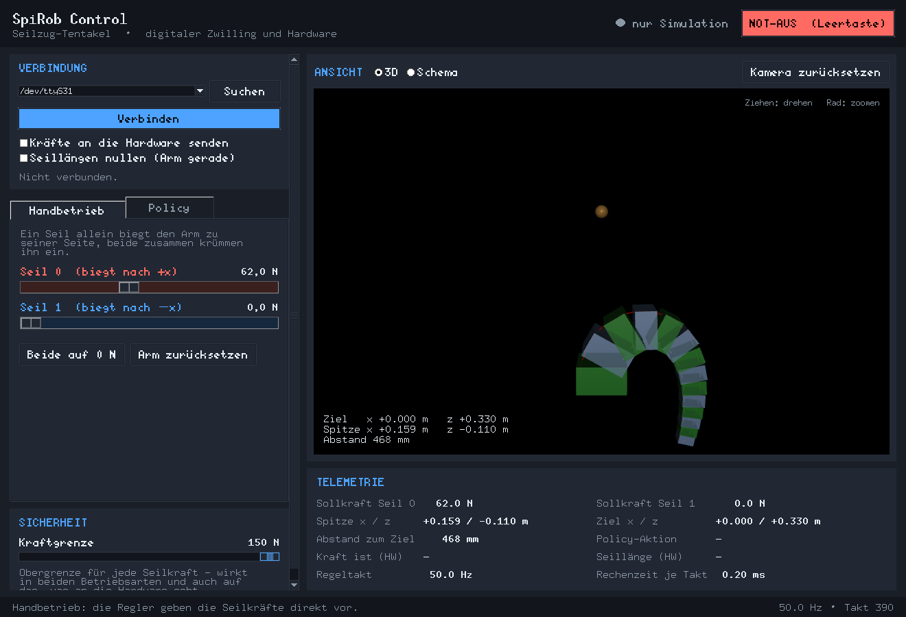
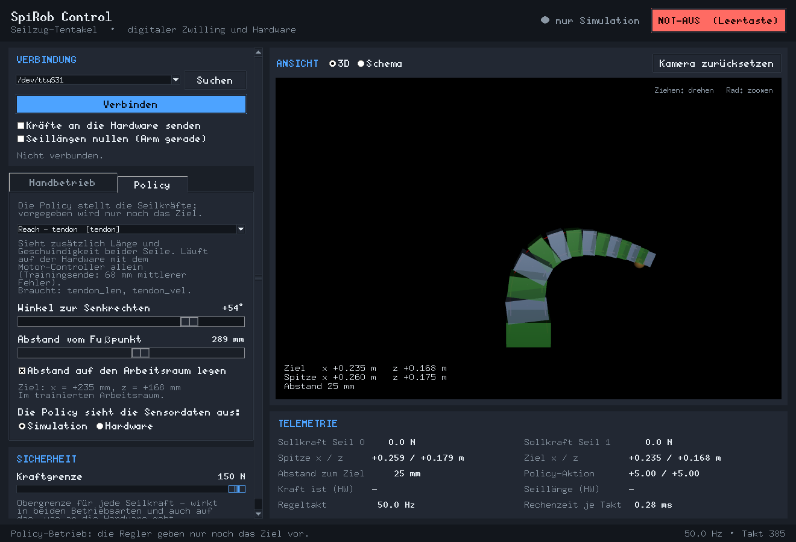
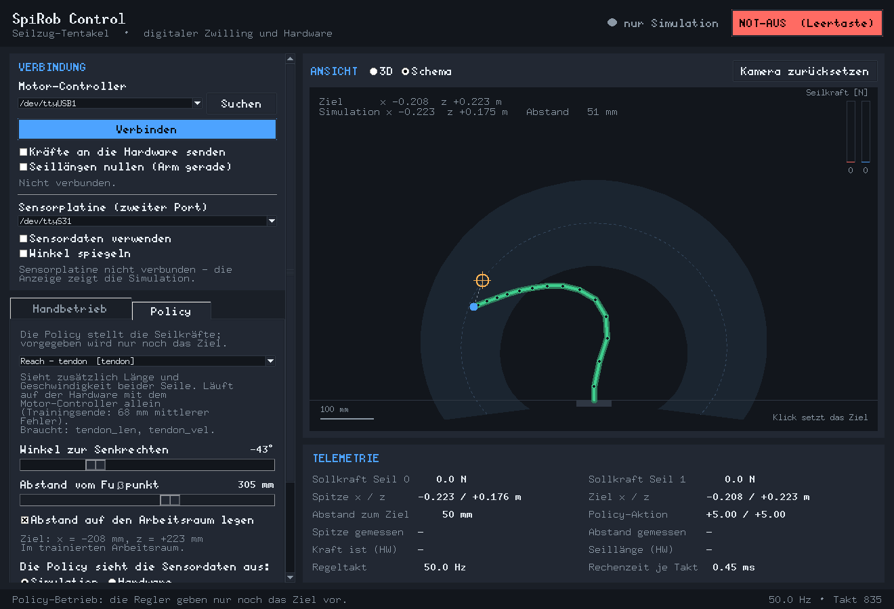
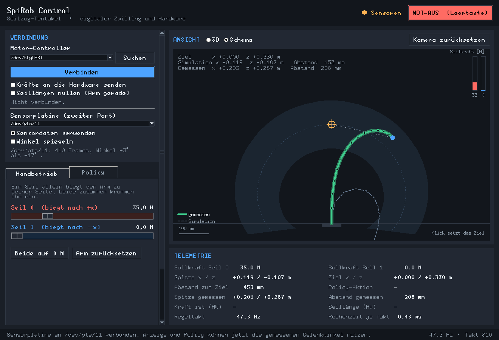

# Bedienung

Das Fenster ist in drei Bereiche geteilt: links die Bedienelemente, rechts die
Ansicht des Roboters und darunter die Telemetrie, ganz unten eine Statuszeile.
Oben rechts sitzen die beiden wichtigsten Anzeigen: ob die Hardware Kräfte
bekommt – und der **Not-Aus**.

## Auf einen Blick

| Element                     | Bedeutung                                                                 |
| --------------------------- | ------------------------------------------------------------------------- |
| `● nur Simulation`          | Es ist keine Hardware verbunden; alles bleibt im digitalen Zwilling.       |
| `● Motor` (gelb)            | Motor-Controller verbunden, aber es werden **keine** Kräfte gesendet.      |
| `● Motor sendet` (grün)     | Die angezeigten Kräfte gehen wirklich an die Motoren.                      |
| `● Sensoren`                | Die Sensorplatine liefert Daten; die Anzeige zeigt den echten Arm.         |
| **NOT-AUS**                 | Kräfte sofort auf 0 N und Kraftregelung stoppen. Auch mit der Leertaste.   |

## Handbetrieb

Das Register **Handbetrieb** hat genau zwei Schieberegler – einen je Seil:

* **Seil 0** biegt den Arm nach **+x** (im Bild nach rechts),
* **Seil 1** biegt ihn nach **−x**.

Der Wert ist die Zugkraft in Newton, von 0 bis 150 N. Zieht nur ein Seil,
krümmt sich der Arm zu dessen Seite; ziehen beide, rollt er sich ein. Die
Kraft wirkt sofort – in der Simulation immer, auf der Hardware nur, wenn
„Kräfte an die Hardware senden“ angehakt ist.

* **Beide auf 0 N** lässt den Arm los, ohne die Verbindung zu trennen.
* **Arm zurücksetzen** (oder `F5`) stellt den simulierten Arm wieder gerade.
  Auf die Hardware wirkt das nicht – die kann man nicht zurücksetzen.

## Policy-Betrieb

Im Register **Policy** stellen wieder zwei Regler alles ein, nur bedeuten sie
jetzt etwas anderes:

* **Winkel zur Senkrechten** – wohin die Spitze zeigen soll, ±97° (±1,7 rad).
* **Abstand vom Fußpunkt** – wie weit die Spitze vom Fuß entfernt sein soll.

Ist **„Abstand auf den Arbeitsraum legen“** angehakt (Voreinstellung), folgt
der Abstand automatisch dem erreichbaren Bereich, und man steuert den Roboter
mit einem einzigen Regler. Der Tentakel ist nicht dehnbar: erreichbare
Positionen liegen nicht flächig, sondern auf einer schmalen, bogenförmigen
Schale. Genau daraus wurden im Training die Ziele gezogen, und genau dort
funktioniert die Policy zuverlässig. Zeigt die Zeile darunter eine gelbe
Warnung, liegt das Ziel außerhalb – die Policy extrapoliert dann, meist mit
zwei voll durchziehenden Seilen als Ergebnis.

**Welche Policy?** Die Auswahlliste enthält vier Netze derselben Aufgabe
(„halte die Spitze am Ziel“), die sich nur darin unterscheiden, welche
Sensordaten sie sehen dürfen – siehe [Policies](policies.md). In der
Simulation sind alle vier nutzbar; `joints` regelt am genauesten, `tendon`
läuft auch auf der Hardware.

**Die Policy sieht die Sensordaten aus …** entscheidet, woher die Rückmeldung
kommt: aus der Simulation (immer möglich) oder aus der echten Hardware. Im
zweiten Fall muss das, was angeschlossen ist, die benötigten Signale liefern:
Seillänge und -geschwindigkeit kommen vom Motor-Controller, Gelenkwinkel und
Segmentneigungen von der Sensorplatine. Fehlt etwas, sagt die Oberfläche
welches Signal und woher es käme, setzt die Kräfte auf null und schaltet zurück
in den Handbetrieb, statt blind weiterzufahren.

## Ansicht

* **3D** zeigt das MuJoCo-Modell. Ziehen dreht die Kamera, das Mausrad zoomt,
  „Kamera zurücksetzen“ stellt die Seitenansicht wieder her. Die orange Kugel
  ist das kommandierte Ziel.
* **Schema** zeichnet dieselbe Szene flach: der graue Ring ist der trainierte
  Arbeitsraum, die gestrichelte Linie dessen Mittellinie, das orange Kreuz das
  Ziel, der blaue Punkt die Spitze. Ein **Klick setzt das Ziel** direkt dorthin
  (im Policy-Betrieb). Rechts stehen zwei Balken für die aktuellen Seilkräfte.
  Hängt die Sensorplatine, zeigt die grüne Linie den gemessenen Arm und die
  blasse gestrichelte die Simulation (Legende unten links).

Die Schema-Ansicht braucht keine Grafikkarte und ist die Rückfallebene, wenn
das 3D-Rendering nicht startet.

## Hardware verbinden

Die Oberfläche spricht mit zwei Geräten an zwei USB-Ports. Beide sind optional -
ohne sie läuft alles in der Simulation weiter.

### Motor-Controller (bewegt den Arm)

1. USB-Kabel anstecken, **Suchen** drücken, den Port auswählen (unter Windows
   `COM3` o. ä.).
2. **Verbinden** – die Oberfläche startet die Kraftregelung auf dem Controller
   und beginnt, die Telemetrie zu lesen.
3. Erst jetzt **„Kräfte an die Hardware senden“** anhaken. Bis dahin bewegt
   sich nichts; man kann also in Ruhe eine Kraft einstellen und dann freigeben.

„Seillängen nullen (Arm gerade)“ setzt beim Verbinden den Nullpunkt der
Seillängenmessung auf die aktuelle Lage. Das ist **nur richtig, wenn der Arm
gerade hängt** – andernfalls passen die Messwerte nicht mehr zu dem, was die
Policy im Training gesehen hat.

### Sensorplatine (misst, wo der Arm steht)

1. Die Platine an einen **zweiten** USB-Port stecken und unter „Sensorplatine
   (zweiter Port)“ auswählen.
2. **„Sensordaten verwenden“** anhaken – der Haken ist zugleich der
   Verbindungsschalter. Darunter stehen dann Port, erkannte Baudrate, die
   Anzahl der empfangenen Frames und der Bereich der gemessenen Winkel. Kommen
   keine Frames an, nennt dieselbe Zeile den Grund (siehe
   [Hardware](hardware.md), Abschnitt „Wenn es nicht geht“); der Haken geht
   dann von selbst wieder heraus.
3. Den Arm ein Stück von Hand biegen und prüfen, ob die grüne Linie im Schema
   der wirklichen Bewegung folgt. Geht sie zur falschen Seite: **„Winkel
   spiegeln“** anhaken.

Sobald Sensordaten fließen, ändert sich die Anzeige:

* Die **Schema-Ansicht** zeichnet die gemessene Armform kräftig grün, die
  Simulation nur noch als blasse gestrichelte Linie dahinter. Der Abstand
  zwischen beiden Linien ist der Unterschied zwischen Modell und Wirklichkeit.
* Die **3D-Ansicht** legt die gemessene Form als grünen Strang über das Modell.
* Die Telemetrie zeigt zusätzlich **„Spitze gemessen“** und **„Abstand
  gemessen“**. Erst dieser zweite Wert ist eine Messung; „Abstand zum Ziel“
  darüber ist der Wert der Simulation.
* Im Policy-Betrieb lässt sich unter „Die Policy sieht die Sensordaten aus“ auf
  **Hardware** umschalten – dann regelt die Policy auf den echten Gelenkwinkeln.

Kommt eine Sekunde lang kein Frame mehr, gelten die Daten als veraltet: Die
Anzeige fällt auf die Simulation zurück, und eine Policy, die die Sensorwerte
braucht, geht in den Handbetrieb. Eine eingefrorene Armform wäre die
gefährlichere Antwort.

## Sicherheit

* **Kraftgrenze**: eine Obergrenze für jede Seilkraft, wirksam in beiden
  Betriebsarten und auch für das, was an die Hardware geht. Für die ersten
  Versuche am realen Aufbau lohnt es sich, hier deutlich unter 150 N zu bleiben.
* **NOT-AUS** (Leertaste, oder `Esc`): setzt beide Kräfte auf 0 N und stoppt
  die Kraftregelung auf dem Controller. Erneut drücken hebt ihn wieder auf,
  die Kräfte bleiben dabei zunächst bei 0 N.
* Beim Schließen des Fensters werden die Motoren gestoppt und der Port
  geschlossen – auch dann, wenn zwischendurch etwas schiefgegangen ist.

## Tastenkürzel

| Taste            | Wirkung                                    |
| ---------------- | ------------------------------------------ |
| `Leertaste`      | Not-Aus auslösen bzw. aufheben              |
| `Esc`            | Not-Aus auslösen                            |
| `F5`             | simulierten Arm zurücksetzen                |
| `Strg` und `+`   | Bedienelemente vergrößern                   |
| `Strg` und `−`   | Bedienelemente verkleinern                  |
| `Strg` und `0`   | zurück auf Originalgröße                    |

## Größe der Bedienelemente

Oben rechts stehen drei Knöpfe: **A−**, der aktuelle Faktor und **A+**. Sie
vergrößern Schrift, Schieberegler, Textumbrüche und die Breite der Seitenleiste
gemeinsam, von 70 % bis 180 % – nützlich für Vorführungen am Beamer oder auf
einem hochauflösenden Bildschirm, auf dem alles zu klein gerät. Der Faktor wird
gemerkt und beim nächsten Start wiederhergestellt.

Die Ansicht des Roboters skaliert davon unabhängig immer auf die volle
verfügbare Fläche.

## Telemetrie

| Feld                  | Bedeutung                                                             |
| --------------------- | --------------------------------------------------------------------- |
| Sollkraft Seil 0 / 1  | Was gerade gestellt wird – nach Kraftgrenze und Not-Aus.               |
| Spitze x / z          | Position der Spitze im digitalen Zwilling [m].                        |
| Ziel x / z            | Kommandiertes Ziel [m].                                                |
| Abstand zum Ziel      | Der Abstand zwischen beiden, in mm – die Größe, auf die trainiert wurde. |
| Spitze gemessen       | Wo die Spitze laut Sensorplatine wirklich steht [m].                   |
| Abstand gemessen      | Der gemessene Zielabstand – ohne Platine leer.                          |
| Policy-Aktion         | Die rohe Netzausgabe, bevor sie in Kräfte umgerechnet wird.            |
| Kraft ist (HW)        | Was der Controller tatsächlich misst.                                  |
| Seillänge (HW)        | Aufgewickelte Seillänge je Motor [mm].                                 |
| Regeltakt             | Tatsächlich erreichte Taktrate; sollte bei 50 Hz liegen.               |
| Rechenzeit je Takt    | Wie viel der 20 ms je Takt gebraucht werden.                           |
