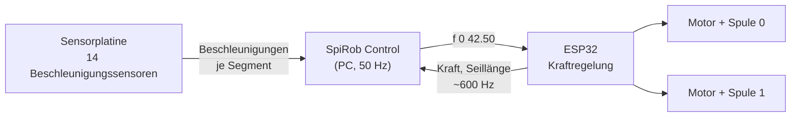
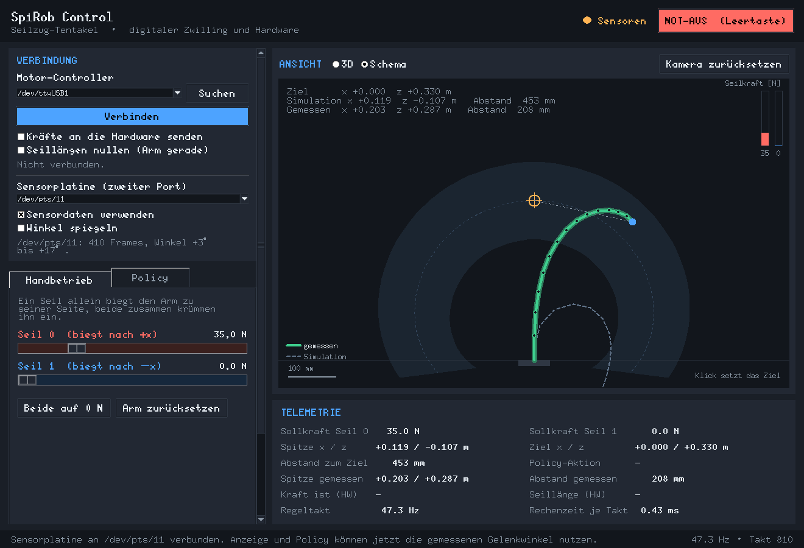

# Hardware

## Aufbau

An der Oberfläche hängen zwei Geräte an zwei USB-Ports:

* der **ESP32-Motorcontroller** - er treibt die beiden Seilspulen und regelt
  die Zugkraft. Ohne ihn bewegt sich nichts.
* die **Sensorplatine** - 14 Beschleunigungssensoren entlang des Arms, aus
  denen die 13 Gelenkwinkel und damit die tatsächliche Form des Arms folgen.
  Sie ist optional, aber sie ist die einzige Möglichkeit, den echten Roboter
  zu *sehen* statt nur zu kommandieren.



Verbindung: USB, **460800 Baud** zum Motorcontroller, **1 MBaud** zur
Sensorplatine, jeweils 8N1.

## Protokoll

**Vom PC zum Controller** – ASCII-Zeilen, mit `\n` abgeschlossen:

| Kommando        | Wirkung                                                        |
| --------------- | -------------------------------------------------------------- |
| `start all`     | Kraftregelung für beide Motoren einschalten                     |
| `f <i> <newton>`| Sollkraft für Motor `i` (0 oder 1) setzen, als positiver Betrag |
| `n all`         | Seillängenmessung auf die aktuelle Lage nullen                  |
| `stop`          | Kraftregelung aus, Motoren stromlos                             |

**Vom Controller zum PC** – fortlaufend, unaufgefordert, etwa 600-mal je
Sekunde, 22 Byte je Paket:

```text
0xAA 0x55 | uint32 zeitstempel_us | float kraft_0 | float kraft_1
          | float seil_0_mm | float seil_1_mm
```

Daneben gibt es ein 3-Byte-Paket `0xBB 0x66` + Motorindex („Schritt zu Ende“),
das diese Oberfläche nie auslöst, aber überliest, damit ein Streupaket den
Parser nicht aus dem Tritt bringt.

Die GUI leert den Empfangspuffer in jedem Takt und behält nur das jüngste
Paket. Der Controller sendet zwölfmal schneller, als geregelt wird; für einen
Regelschritt zählt allein „wie sieht es jetzt aus“. Das ist zugleich die
einfachste und die verzögerungsärmste Variante.

Gesendet wird höchstens 50-mal je Sekunde und nur, wenn sich die Sollkraft um
mehr als 0,05 N geändert hat. Der Not-Aus umgeht beide Drosseln – er muss auch
dann ankommen, wenn er sich vom letzten Wert kaum unterscheidet.

## Inbetriebnahme

1. Arm gerade aushängen lassen, USB anstecken.
2. In der GUI **Suchen** drücken und den Port wählen (Windows: `COM3` o. ä.;
   Linux: `/dev/ttyUSB0`).
3. Optional **„Seillängen nullen (Arm gerade)“** ankreuzen – nur, wenn der Arm
   wirklich gerade hängt.
4. **Verbinden**. In der Telemetrie müssen jetzt „Kraft ist (HW)“ und
   „Seillänge (HW)“ Werte zeigen; bleiben sie leer, stimmt Port oder Baudrate
   nicht.
5. **Kraftgrenze** herunterdrehen (für die ersten Versuche z. B. 40 N).
6. Erst dann **„Kräfte an die Hardware senden“** anhaken.

## Sicherheit

!!! warning "Der Arm bewegt sich sofort"
    Sobald „Kräfte an die Hardware senden“ aktiv ist, wirkt jede Reglerbewegung
    unmittelbar auf die Motoren. Vorher Hände aus dem Arbeitsraum und einen
    freien Weg für den Arm lassen.

* Die **Kraftgrenze** wirkt vor dem Senden und begrenzt beide Betriebsarten.
* Der **Not-Aus** (Leertaste) setzt beide Kräfte auf 0 N und sendet `stop`.
* Beim Schließen des Fensters wird ebenfalls gestoppt und der Port geschlossen.
* Bricht die Verbindung während des Betriebs weg, meldet die GUI das und fährt
  in der Simulation weiter. Der Controller bleibt dann mit seiner letzten
  Sollkraft stehen – im Zweifel Kabel neu anstecken und `stop` über einen
  erneuten Verbindungsaufbau schicken.

## Die Sensorplatine

### Was sie liefert

Auf jedem der 14 Segmente sitzt ein Beschleunigungssensor. In Ruhe misst er die
Richtung der Schwerkraft und damit die Neigung seines Segments; die Differenz
zweier benachbarter Neigungen ist der Gelenkwinkel dazwischen. Weil alle
Gelenke um dieselbe Achse drehen, lässt sich das geschlossen ausrechnen:

```text
phi_i = atan2(a_z, a_y)          Neigung von Segment i
q_i   = phi_i - phi_(i+1)        Gelenkwinkel zwischen i und i+1
```

Das ist keine Näherung - das Problem zerfällt in 13 unabhängige
Ein-Parameter-Probleme, und diese Ablesung trifft deren Minimum exakt. Sie
kostet Bruchteile einer Millisekunde und braucht kein SciPy.

Damit stehen drei Dinge zur Verfügung:

| Größe | Wofür |
| ----- | ----- |
| `joint_pos`, `joint_vel` | Beobachtung für Policies des Sensor-Levels `joints` |
| `segment_pitch` | Beobachtung für Sensor-Level `imu` |
| Armform und Spitzenposition | Anzeige und der **gemessene** Zielabstand |

### Protokoll

Binärstrom, 1 MBaud:

```text
Kopf (12 B): 0xAA 0x55 | frame_id(u32) | t_esp_us(u32) | mode(u8) | n(u8)
je Sensor:   sensor_id(u8) + 3 float32   (Modus ACC)
             sensor_id(u8) + 6 float32   (Modus ACC+MAG)
```

Beim Verbinden schickt die GUI ein `a` und stellt die Platine damit auf reine
Beschleunigungsdaten - die höchste Bildrate, und mehr wird nicht gebraucht.
Wie beim Motorcontroller wird je Takt der Puffer geleert und nur der jüngste
vollständige Frame ausgewertet. Ein Frame, der von keinem weiteren Kopf gefolgt
wird, gilt als Fehltreffer und wird verworfen; das fängt verlorene Bytes ab,
ohne den Parser aus dem Tritt zu bringen.

Kommt eine Sekunde lang kein Frame mehr, gelten die Winkel als veraltet: Die
Anzeige fällt auf die Simulation zurück und eine Policy, die die Sensordaten
braucht, geht in den Handbetrieb. Eine eingefrorene Armform wäre die
gefährlichere Antwort.

### Inbetriebnahme

1. Die Platine an einen **zweiten** USB-Port stecken, **Suchen** drücken.
2. Unter „Sensorplatine (zweiter Port)“ den Port auswählen.
3. **„Sensordaten verwenden“** anhaken - das ist zugleich der
   Verbindungsschalter. Darunter erscheinen die Anzahl der empfangenen Frames
   und der Bereich der gemessenen Winkel.
4. Den Arm von Hand ein Stück biegen und die Schema-Ansicht beobachten: Die
   grüne Linie muss der wirklichen Bewegung folgen. Biegt sie sich zur
   **falschen** Seite, **„Winkel spiegeln“** anhaken - ob eine Biegung positive
   oder negative Winkel liefert, hängt daran, wie herum die Platine montiert
   ist, und das kann die Software nicht wissen.

!!! note "Die Reihenfolge der Sensoren"
    Voreingestellt ist die Zuordnung `0,1,…,7,32,…,37` von der Basis zur
    Spitze, also die Reihenfolge der Platine selbst. Bewegt sich beim Biegen
    eines einzelnen Gelenks in der Anzeige das falsche Gelenk, stimmt diese
    Zuordnung nicht; sie steht als `SENSOR_IDS` in
    `src/spirob_control/sensors.py`.

### Was die Anzeige damit macht

Sobald Sensordaten fließen, zeigt die **Schema-Ansicht** die gemessene Armform
kräftig grün und die Simulation nur noch als blasse gestrichelte Linie
dahinter. Der Abstand zwischen beiden Linien ist der Sim-to-Real-Unterschied.



In der 3D-Ansicht wird die gemessene Form als grüner Strang über das Modell
gelegt. Die Telemetrie bekommt zwei zusätzliche Felder: „Spitze gemessen“ und
„Abstand gemessen“ - und erst dieser zweite Wert ist wirklich eine Messung.
Ohne Platine bleiben beide Felder leer, statt die Simulation als Messung
auszugeben.

## Welche Policy läuft womit?

| Sensor-Level | Simulation | Nur Motorcontroller | Motorcontroller + Sensorplatine |
| ------------ | :--------: | :-----------------: | :-----------------------------: |
| `force`      | ja         | ja                  | ja                              |
| `tendon`     | ja         | ja                  | ja                              |
| `imu`        | ja         | nein                | ja                              |
| `joints`     | ja         | nein                | ja                              |

Fehlt einer Policy ein Signal, sagt die Oberfläche welches und woher es käme,
setzt die Kräfte auf null und geht in den Handbetrieb - statt einen
unvollständigen Beobachtungsvektor zu erfinden.

## Was noch fehlt

* Eine Messreihe auf der echten Hardware: Zielabweichung je Sensor-Level über
  den ganzen Arbeitsraum, gemessen statt simuliert. Alles dafür Nötige ist
  jetzt vorhanden - die Oberfläche zeigt den gemessenen Zielabstand live an.
* Ein Aufzeichnen dieser Werte aus der Oberfläche heraus (bisher müssen sie
  abgelesen werden).
