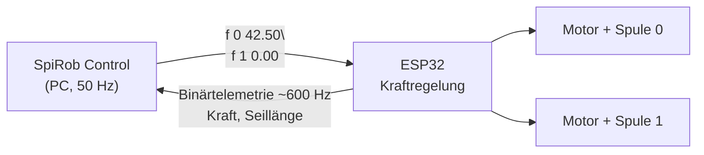

# Hardware

## Aufbau

An der Oberfläche hängt genau ein Gerät: der **ESP32-Motorcontroller** des
SpiRob. Er treibt die beiden Seilspulen und regelt die Zugkraft; die GUI gibt
ihm nur Sollkräfte vor und liest seine Telemetrie mit.



Verbindung: USB, **460800 Baud**, 8N1.

## Protokoll

**Vom PC zum Controller** – ASCII-Zeilen, mit `\n` abgeschlossen:

| Kommando        | Wirkung                                                        |
| --------------- | -------------------------------------------------------------- |
| `start all`     | Kraftregelung für beide Motoren einschalten                     |
| `f <i> <newton>`| Sollkraft für Motor `i` (0 oder 1) setzen, als positiver Betrag |
| `n all`         | Seillängenmessung auf die aktuelle Lage nullen                  |
| `stop`          | Kraftregelung aus, Motoren stromlos                             |

**Vom Controller zum PC** – fortlaufend, unaufgefordert, etwa 600-mal je
Sekunde, 22 Byte je Paket:

```text
0xAA 0x55 | uint32 zeitstempel_us | float kraft_0 | float kraft_1
          | float seil_0_mm | float seil_1_mm
```

Daneben gibt es ein 3-Byte-Paket `0xBB 0x66` + Motorindex („Schritt zu Ende“),
das diese Oberfläche nie auslöst, aber überliest, damit ein Streupaket den
Parser nicht aus dem Tritt bringt.

Die GUI leert den Empfangspuffer in jedem Takt und behält nur das jüngste
Paket. Der Controller sendet zwölfmal schneller, als geregelt wird; für einen
Regelschritt zählt allein „wie sieht es jetzt aus“. Das ist zugleich die
einfachste und die verzögerungsärmste Variante.

Gesendet wird höchstens 50-mal je Sekunde und nur, wenn sich die Sollkraft um
mehr als 0,05 N geändert hat. Der Not-Aus umgeht beide Drosseln – er muss auch
dann ankommen, wenn er sich vom letzten Wert kaum unterscheidet.

## Inbetriebnahme

1. Arm gerade aushängen lassen, USB anstecken.
2. In der GUI **Suchen** drücken und den Port wählen (Windows: `COM3` o. ä.;
   Linux: `/dev/ttyUSB0`).
3. Optional **„Seillängen nullen (Arm gerade)“** ankreuzen – nur, wenn der Arm
   wirklich gerade hängt.
4. **Verbinden**. In der Telemetrie müssen jetzt „Kraft ist (HW)“ und
   „Seillänge (HW)“ Werte zeigen; bleiben sie leer, stimmt Port oder Baudrate
   nicht.
5. **Kraftgrenze** herunterdrehen (für die ersten Versuche z. B. 40 N).
6. Erst dann **„Kräfte an die Hardware senden“** anhaken.

## Sicherheit

!!! warning "Der Arm bewegt sich sofort"
    Sobald „Kräfte an die Hardware senden“ aktiv ist, wirkt jede Reglerbewegung
    unmittelbar auf die Motoren. Vorher Hände aus dem Arbeitsraum und einen
    freien Weg für den Arm lassen.

* Die **Kraftgrenze** wirkt vor dem Senden und begrenzt beide Betriebsarten.
* Der **Not-Aus** (Leertaste) setzt beide Kräfte auf 0 N und sendet `stop`.
* Beim Schließen des Fensters wird ebenfalls gestoppt und der Port geschlossen.
* Bricht die Verbindung während des Betriebs weg, meldet die GUI das und fährt
  in der Simulation weiter. Der Controller bleibt dann mit seiner letzten
  Sollkraft stehen – im Zweifel Kabel neu anstecken und `stop` über einen
  erneuten Verbindungsaufbau schicken.

## Grenzen des Hardwarebetriebs

Der Motor-Controller liefert **Kraft** und **Seillänge**. Damit sind auf der
echten Hardware die Policies der Sensor-Level `force` und `tendon` lauffähig.

Die Level `imu` und `joints` brauchen die Segmentneigungen bzw. die 13
Gelenkwinkel. Beides misst die **Beschleunigungssensor-Platine**, die an einem
zweiten USB-Port hängt und von dieser Oberfläche noch nicht gelesen wird. Wählt
man eine solche Policy und stellt die Rückmeldung auf „Hardware“, sagt die GUI
genau das und schaltet zurück in den Handbetrieb, statt einen unvollständigen
Beobachtungsvektor zu erfinden.

In der **Simulation** sind alle vier Policies uneingeschränkt nutzbar, weil der
digitale Zwilling jedes Signal liefern kann.

## Was noch fehlt

* Anbindung der Beschleunigungssensor-Platine als zweite Datenquelle. Damit
  wären `imu` und `joints` auch auf der Hardware fahrbar – und aus den
  Gelenkwinkeln ließe sich über die Vorwärtskinematik die **gemessene**
  Position der Spitze berechnen. Heute zeigt die Telemetrie als „Spitze“ die
  Position im digitalen Zwilling, nicht die des echten Arms.
* Eine Messreihe auf der echten Hardware: Zielabweichung je Sensor-Level,
  gefahren über den ganzen Arbeitsraum.
